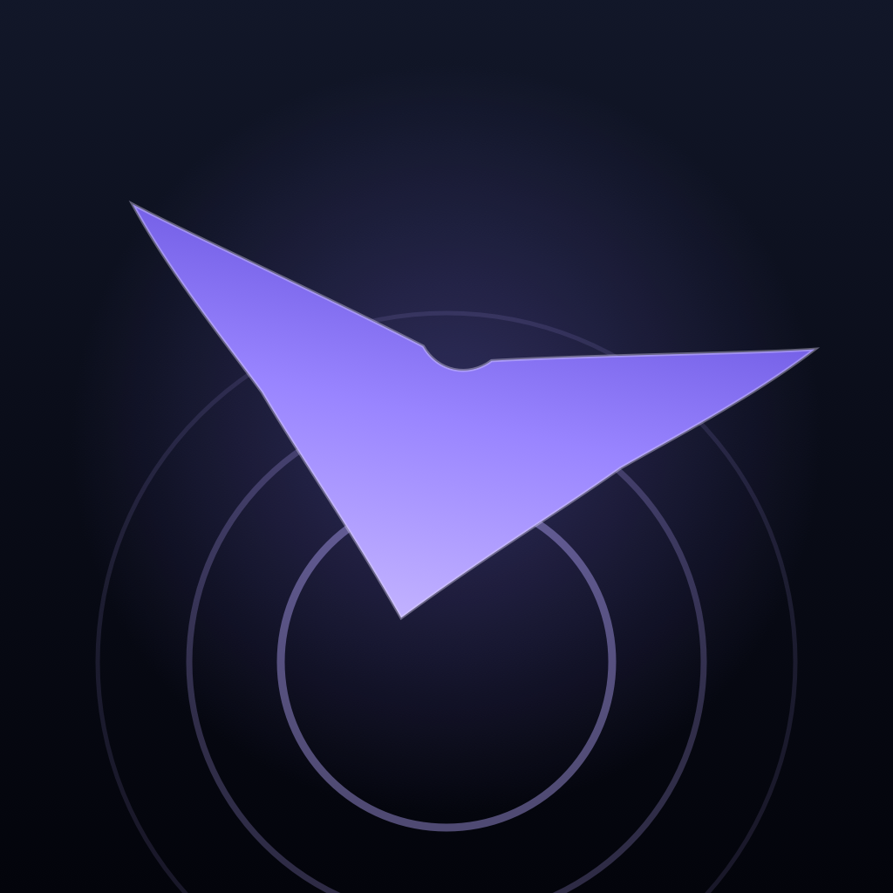
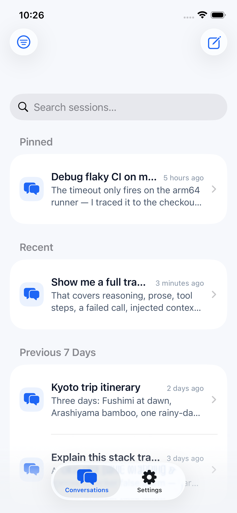
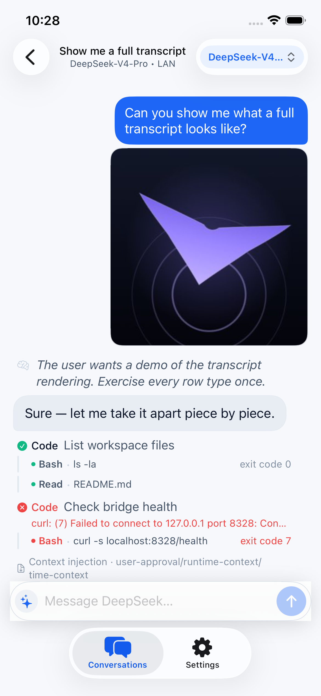
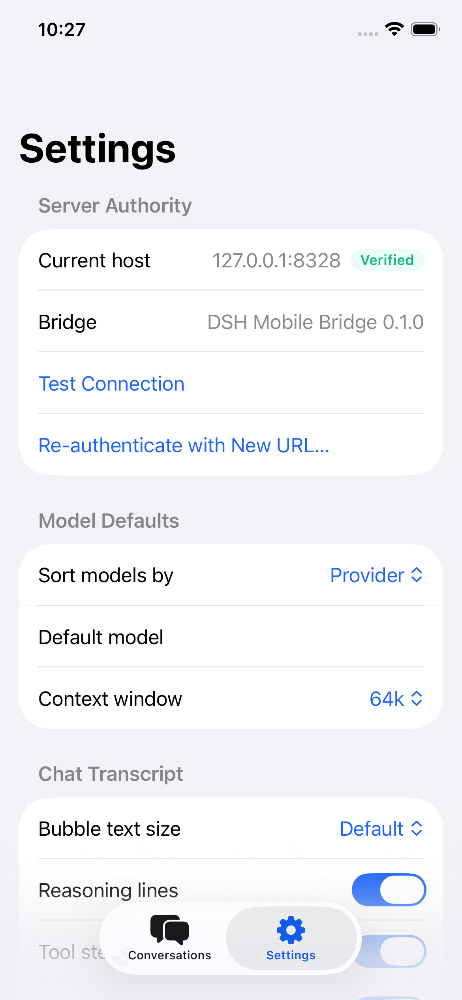

<div align="center">



# DSH Mobile

**Your DeepSeek harness, in your pocket.**
A native iOS client for a DeepSeek Harness (dsh) installation running on your own machine.
</div>

---

DSH Mobile connects straight to the harness over your LAN (or Tailnet) through a small dsh plugin
called the **mobile bridge**. No cloud, no accounts, no telemetry — the app talks to *your* model
on *your* hardware.

- **Live sessions** — every desktop conversation, with real titles, model badges, and last-message previews
- **Pin & archive** — synced with the harness itself, so state matches the desktop after a refresh
- **Model switching** — pick any model from the full harness catalog, per chat or as a default
- **Full transcripts** — reasoning, tool steps with sub-calls, injected context, and image attachments
- **Face ID lock**, appearance modes, streaming haptics, and more under Settings
- **In-app updates** — Settings checks GitHub Releases and hands new builds straight to SideStore

| Conversations | Transcript | Settings |
| :-: | :-: | :-: |
|  |  |  |

## How it works

```
iPhone ──LAN──▶ dsh mobile-bridge plugin (:8328) ──▶ harness sessions / models / prompts
```

The bridge is a single-file Cordis plugin (`plugin/mobile-bridge/`) that exposes a small REST
surface: `/health`, `/sessions`, `/sessions/:id/{messages,prompt,model,archive,pin}`,
`/models`, `/attachments/:sha`.

### 1. Add the bridge plugin to your harness

In the DeepSeek Harness desktop app:

1. **Plugins → Add plugin**
2. Paste the local path to the `plugin/mobile-bridge` directory of this repo and confirm.

The bridge opens port `8328` on all interfaces at the next harness start and logs the reachable
LAN addresses (`curl http://<your-machine-ip>:8328/health` to confirm).

Or skip the manual steps — paste this into any coding agent running on the machine that hosts
your harness:

```text
Set up DSH Mobile on this machine. Clone https://github.com/footfungus2/DSH-mobile and install
the plugin/mobile-bridge Cordis plugin into my DeepSeek Harness workspace the same way the
"Plugins → Add plugin" dialog does, then restart the harness so the bridge loads. Verify it with
`curl http://localhost:8328/health` and tell me the LAN URL to enter in the DSH Mobile app.
```

### 2. Connect the app

Install the app (see below), open it, and enter the bridge URL —
`http://<your-machine-ip>:8328` — on the Connect screen.

## Building the app

Requires Xcode 15+ and [XcodeGen](https://github.com/yonaskolb/XcodeGen) (`brew install xcodegen`).

```sh
xcodegen generate
xcodebuild -project DSHMobile.xcodeproj -scheme DSHMobile \
  -sdk iphonesimulator -configuration Debug build
```

For a real device (or a sideloading tool such as **SideStore**), build the iPhone target with
your own signing identity — bundle id `com.yourname.DSHMobile`.

## Releases & in-app updates

Every `v*` tag triggers the GitHub Action that builds an `.ipa` and publishes a Release with
auto-generated changelog notes, an installable `DSH-Mobile.ipa`, and a SideStore
`manifest.json`. In the app: **Settings → Updates → Check for updates** — if a newer version
exists, it hands the release manifest to SideStore and the update installs without ever leaving
the app.

## Layout

```
plugin/mobile-bridge/   the dsh Cordis plugin (the bridge itself)
DSHMobile/              SwiftUI app sources
scripts/                asset generation (app icon rasterizer)
.github/workflows/      tagged IPA build + release automation
```

## Notes

- Traffic stays inside your local network (or Tailnet); TLS-optional plain HTTP is the default.
- Credentials and chat state stay on-device; nothing leaves your LAN except prompts you send.
